# 📋 Oikos (KCF Finance) — Expense Manager: Complete Project Report

> **Project Name:** Oikos — Expense Manager for Donation-Based Institutions  
> **Version:** 2.0.0  
> **Date:** 29 October 2026  
> **Tech Stack:** Node.js, Express, SQLite (local) / MongoDB Atlas (production), Vanilla JS, Chart.js  

---

## Table of Contents

1. [Project Overview](#1-project-overview)
2. [Features (Detailed)](#2-features-detailed)
3. [Database Diagrams](#3-database-diagrams)
   - 3.1 [Entity-Relationship (ER) Diagram](#31-entity-relationship-er-diagram)
   - 3.2 [Data Flow Diagrams (DFD)](#32-data-flow-diagrams-dfd)
   - 3.3 [Use Case Diagram](#33-use-case-diagram)
   - 3.4 [Sequence Diagrams](#34-sequence-diagrams)
   - 3.5 [Class Diagram (API Architecture)](#35-class-diagram-api-architecture)
   - 3.6 [State Diagram (Budget Enforcement)](#36-state-diagram-budget-enforcement)
4. [Implementation in Real](#4-implementation-in-real)
5. [Project Report (Progress)](#5-project-report-progress)

---

## 1. Project Overview

**Oikos (KCF Finance)** is a comprehensive web-based expense and budget management application specifically designed for **donation-based institutions** — orphanages, churches, NGOs, and similar organizations. The system allows administrators to manage multiple organisations, categorize expenses, track income sources (donations, grants), set per-category budget limits, and visualize spending via a dashboard with interactive charts.

The application features a **dual-database architecture**:
- **SQLite** (via Node.js built-in `node:sqlite`) for local development
- **MongoDB Atlas** for cloud production deployment on Vercel

> [!IMPORTANT]
> The project is hosted **100% free 24/7** using GitHub (source code), Vercel (serverless hosting), and MongoDB Atlas Free Tier (512 MB cloud database).

---

## 2. Features (Detailed)

### 2.1 Organisation Management
| Feature | Description |
|:--------|:------------|
| **Create Organisation** | Add new institutions with name, type (Orphanage / Church / NGO), address, and contact |
| **Edit Organisation** | Inline form-based editing with pre-populated fields |
| **Delete Organisation** | Cascade delete — removes all associated categories, expenses, income, and budgets |
| **View All** | Tabular listing with highlighted "Selected" row badge |

### 2.2 Category Management
| Feature | Description |
|:--------|:------------|
| **Per-Organisation Categories** | Each organisation has its own set of expense categories (e.g., Food, Utilities, Games) |
| **Cascading Dropdown** | When an org is selected, only its categories appear in expense & budget forms |
| **Quick Add** | Inline category creation form within the Expenses view |

### 2.3 Expense Tracking
| Feature | Description |
|:--------|:------------|
| **Record Expenses** | Log expenditures with organisation, category, amount, and date |
| **Budget Enforcement** | Before insertion, the system checks if the expense would exceed any active budget — **blocks** the expense if it would |
| **Budget Warning** | If the expense pushes spending past 75% of budget, a warning toast is shown |
| **Live Budget Indicator** | Real-time progress bar appears on the expense form showing budget status as category/date changes |
| **Filtered View** | Expenses can be filtered by organisation |
| **Delete** | Individual expense deletion with automatic dashboard/budget refresh |

### 2.4 Income Tracking
| Feature | Description |
|:--------|:------------|
| **Record Income** | Log donations, grants, and other revenue with source, amount, date, and description |
| **Per-Org Filtering** | Income is scoped to the selected organisation |
| **Delete** | Individual income record deletion |

### 2.5 Budget & Alerts System
| Feature | Description |
|:--------|:------------|
| **Create Budget** | Allocate a spending limit to a specific category for a period |
| **Period Types** | Monthly (`2026-10`), Quarterly (`2026-Q1`), and Yearly (`2026`) |
| **Progress Cards** | Visual cards showing allocated vs spent with animated progress bars |
| **Status Indicators** | On Track (≤75%), Warning (75–100%), Over Budget (>100%) with color coding |
| **Summary Statistics** | Total budgets, total allocated, total spent, and count of over-budget items |
| **Status Filter** | Filter budget cards by On Track / Warning / Over Budget |
| **Enforcement** | Hard block on expenses that would exceed budget limits |

### 2.6 Dashboard & Analytics
| Feature | Description |
|:--------|:------------|
| **Summary Cards** | Total Income, Total Expenses, and Net Balance at a glance |
| **Doughnut Chart** | Expenses broken down by category using Chart.js |
| **Per-Organisation** | All metrics are scoped to the currently selected organisation |

### 2.7 UI/UX Features
| Feature | Description |
|:--------|:------------|
| **Dark Theme** | Modern dark-mode UI with gradient accents |
| **Sidebar Navigation** | Five-section nav: Dashboard, Organisations, Expenses, Income, Budgets |
| **Mobile Responsive** | Hamburger menu with overlay sidebar for mobile devices |
| **Toast Notifications** | Animated success/warning/danger toasts with auto-dismiss and progress bar |
| **localStorage Persistence** | Selected org is remembered across page reloads |

### 2.8 Deployment & DevOps
| Feature | Description |
|:--------|:------------|
| **Vercel Serverless** | Auto-deploys on `git push` with serverless API functions |
| **MongoDB Atlas** | Free-tier cloud database with connection pooling |
| **Local Dev Mode** | `npm start` / `npm run dev` with nodemon hot-reload |
| **Seed Data** | Auto-seeds sample data into empty SQLite database on first run |

---

## 3. Database Diagrams

### 3.1 Entity-Relationship (ER) Diagram

This diagram shows all five core entities, their attributes, primary keys (PK), and foreign key relationships. The `counters` collection (MongoDB-only, used for auto-increment sequences) is also shown.

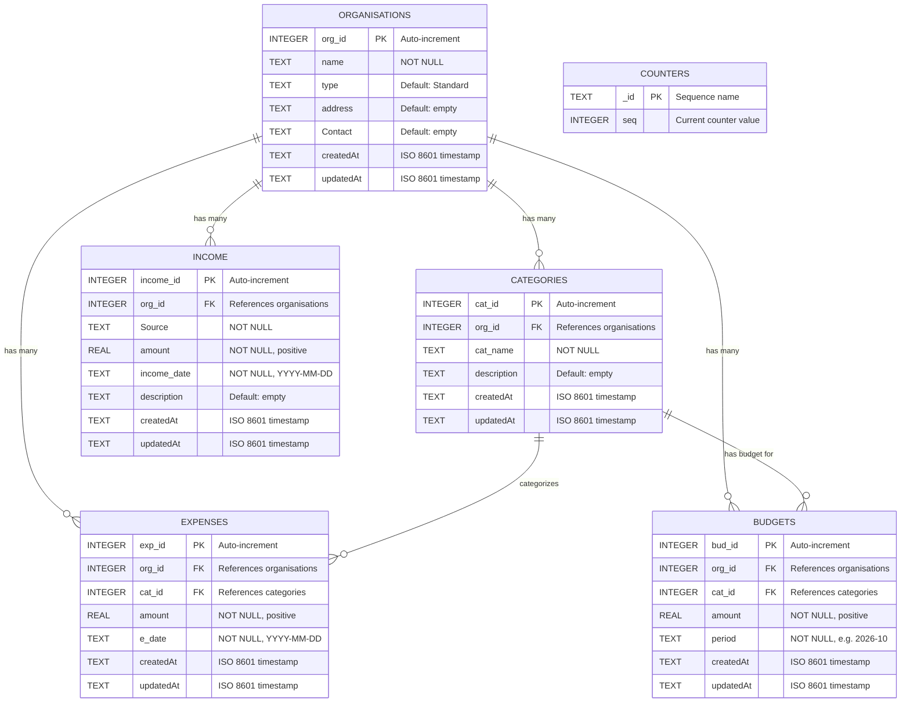

#### ER Diagram — Detailed Explanation

| Relationship | Cardinality | Constraint | Description |
|:-------------|:------------|:-----------|:------------|
| Organisation → Categories | 1:N | `ON DELETE CASCADE` | Deleting an org removes all its categories |
| Organisation → Expenses | 1:N | `ON DELETE CASCADE` | Deleting an org removes all its expenses |
| Organisation → Income | 1:N | `ON DELETE CASCADE` | Deleting an org removes all its income records |
| Organisation → Budgets | 1:N | `ON DELETE CASCADE` | Deleting an org removes all its budgets |
| Category → Expenses | 1:N | `ON DELETE CASCADE` | Deleting a category removes its expenses |
| Category → Budgets | 1:N | `ON DELETE CASCADE` | Deleting a category removes its budget allocations |

> [!NOTE]
> The `counters` table/collection exists **only in MongoDB** to provide atomic auto-incrementing integer IDs (via `findOneAndUpdate` with `$inc`). In SQLite, `AUTOINCREMENT` handles this natively.

---

### 3.2 Data Flow Diagrams (DFD)

#### Level 0 — Context Diagram

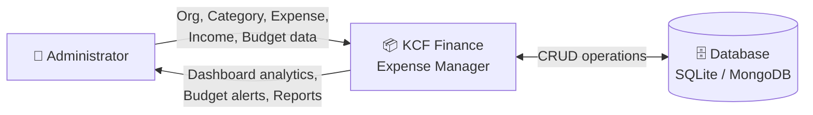

#### Level 1 — Major Process Decomposition

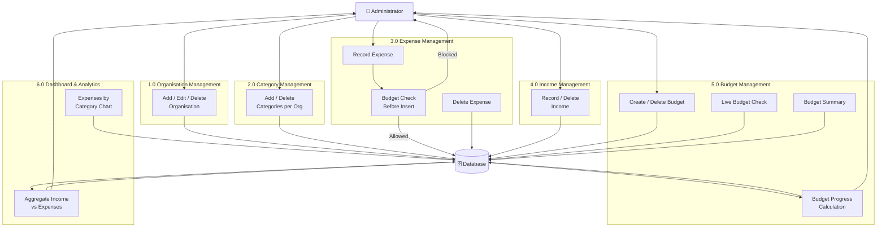

#### Level 2 — Expense Recording Process (Detailed)

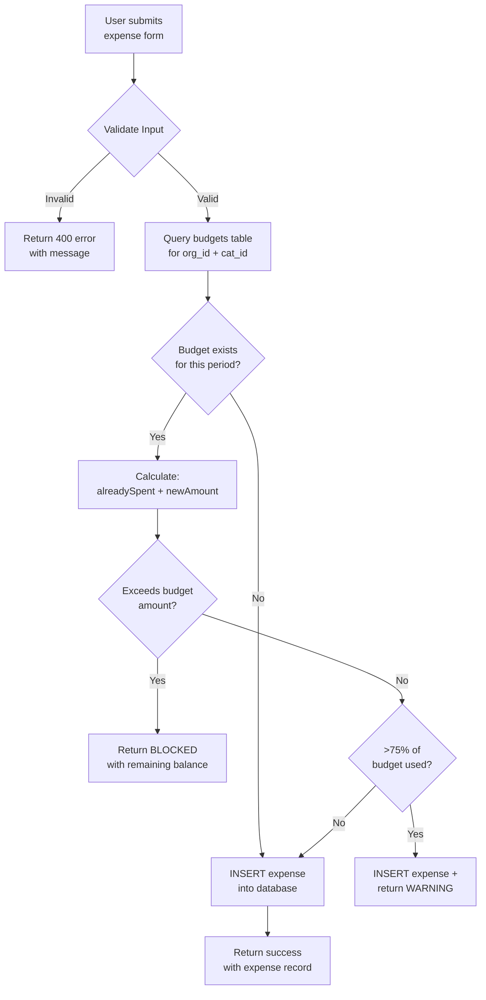

---

### 3.3 Use Case Diagram

```mermaid
flowchart TD
    subgraph Actors
        Admin["👤 Administrator"]
    end

    subgraph UC_System["KCF Finance — Expense Manager"]
        subgraph UC_Org["Organisation Module"]
            UC1["Add Organisation"]
            UC2["Edit Organisation"]
            UC3["Delete Organisation"]
            UC4["View Organisations"]
        end

        subgraph UC_Cat["Category Module"]
            UC5["Add Category"]
            UC6["Delete Category"]
        end

        subgraph UC_Exp["Expense Module"]
            UC7["Record Expense"]
            UC8["View Expenses"]
            UC9["Delete Expense"]
            UC10["Check Budget\nBefore Expense"]
        end

        subgraph UC_Inc["Income Module"]
            UC11["Record Income"]
            UC12["View Income"]
            UC13["Delete Income"]
        end

        subgraph UC_Bud["Budget Module"]
            UC14["Create Budget"]
            UC15["View Budget Progress"]
            UC16["Delete Budget"]
            UC17["Live Budget Check"]
            UC18["Budget Summary"]
        end

        subgraph UC_Dash["Dashboard Module"]
            UC19["View Dashboard"]
            UC20["View Expense Chart"]
        end
    end

    Admin --- UC1
    Admin --- UC2
    Admin --- UC3
    Admin --- UC4
    Admin --- UC5
    Admin --- UC6
    Admin --- UC7
    Admin --- UC8
    Admin --- UC9
    Admin --- UC11
    Admin --- UC12
    Admin --- UC13
    Admin --- UC14
    Admin --- UC15
    Admin --- UC16
    Admin --- UC19

    UC7 -.->|"includes"| UC10
    UC8 -.->|"extends"| UC17
    UC19 -.->|"includes"| UC20
    UC15 -.->|"includes"| UC18
```

#### Use Case Descriptions

| Use Case | Actor | Pre-condition | Post-condition | Description |
|:---------|:------|:--------------|:---------------|:------------|
| **Add Organisation** | Admin | None | Organisation created with unique ID | Admin fills name, type, address, contact and submits |
| **Edit Organisation** | Admin | Org exists | Org data updated | Admin clicks Edit, modifies fields, submits |
| **Delete Organisation** | Admin | Org exists | Org + all children deleted | Cascade deletes categories, expenses, income, budgets |
| **Add Category** | Admin | Org selected | Category created under org | Admin enters category name linked to current org |
| **Record Expense** | Admin | Org & category exist | Expense recorded OR blocked | System checks budget constraints before inserting |
| **Record Income** | Admin | Org selected | Income record created | Admin enters source, amount, date, description |
| **Create Budget** | Admin | Org & category exist | Budget allocated | Admin sets amount for a category over a period |
| **View Dashboard** | Admin | Org selected | Analytics displayed | Shows income/expense totals, category chart |
| **Live Budget Check** | System | Expense form active | Budget status displayed | Real-time indicator as user selects category/date |

---

### 3.4 Sequence Diagrams

#### Sequence 1: Recording an Expense (with Budget Enforcement)

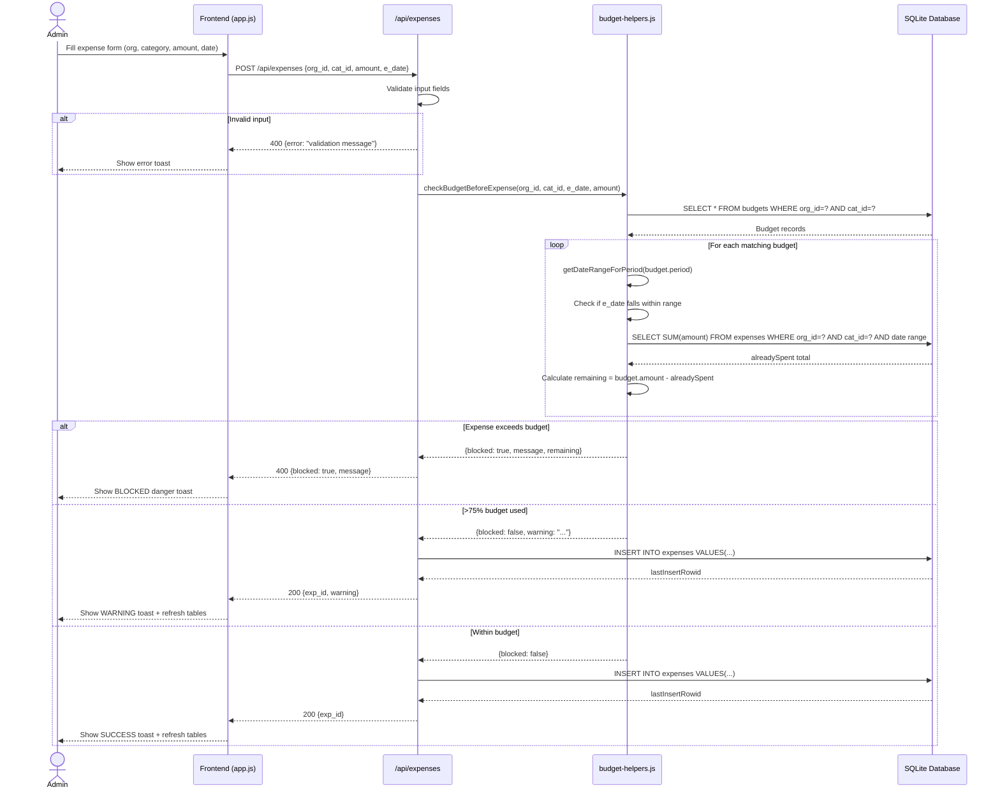

#### Sequence 2: Loading the Dashboard

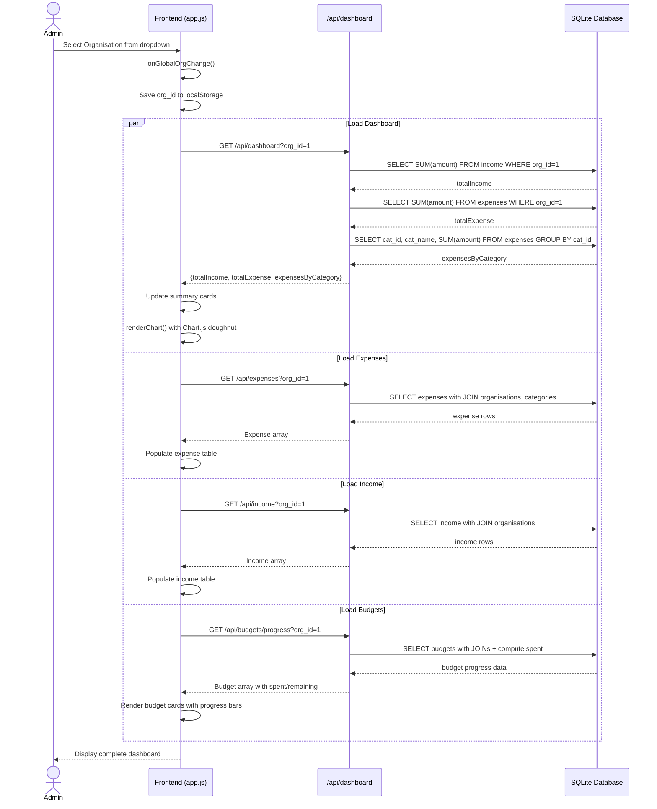

#### Sequence 3: Creating a New Organisation

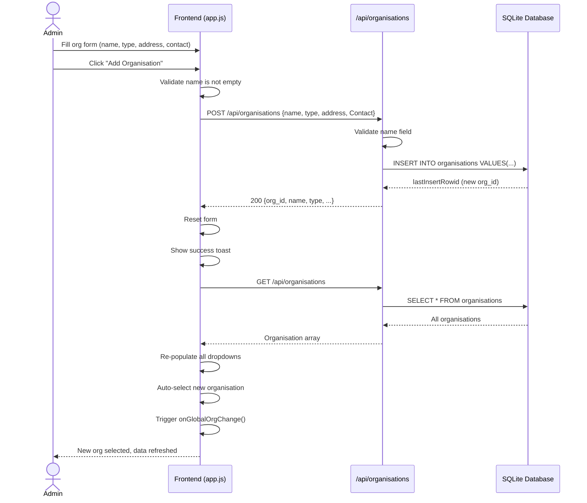

#### Sequence 4: Budget Creation with Period Type Selection

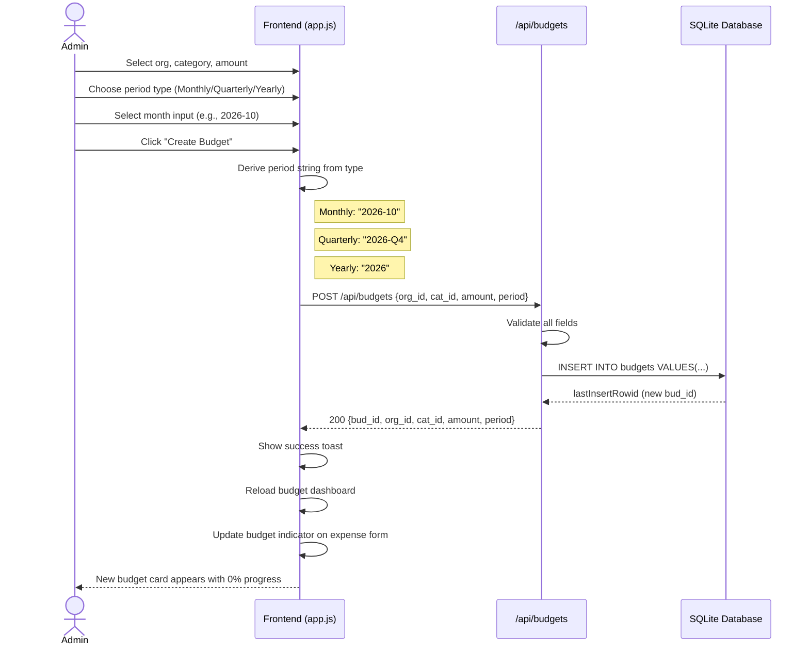

---

### 3.5 Class Diagram (API Architecture)

```mermaid
classDiagram
    class Server {
        +Express app
        +Number PORT
        +listen()
        +use(cors, json, static)
    }

    class OrganisationsAPI {
        +GET() List~Organisation~
        +POST(name, type, address, Contact) Organisation
        +PUT(id, name, type, address, Contact) Message
        +DELETE(id) Message
    }

    class CategoriesAPI {
        +GET() List~Category~
        +POST(org_id, cat_name, description) Category
        +PUT(id, org_id, cat_name, description) Message
        +DELETE(id) Message
    }

    class ExpensesAPI {
        +GET(org_id?) List~Expense~
        +POST(org_id, cat_id, amount, e_date) Expense
        +PUT(id, org_id, cat_id, amount, e_date) Message
        +DELETE(id) Message
    }

    class IncomeAPI {
        +GET(org_id?) List~Income~
        +POST(org_id, Source, amount, income_date, description) Income
        +PUT(id, org_id, Source, amount, income_date, description) Message
        +DELETE(id) Message
    }

    class BudgetsAPI {
        +GET() List~Budget~
        +POST(org_id, cat_id, amount, period) Budget
        +PUT(id, org_id, cat_id, amount, period) Message
        +DELETE(id) Message
    }

    class BudgetProgressAPI {
        +GET(org_id?) List~BudgetWithSpent~
    }

    class BudgetLiveCheckAPI {
        +GET(org_id, cat_id, date) LiveCheckResult
    }

    class BudgetSummaryAPI {
        +GET(org_id, cat_id, period?) List~BudgetSummary~
    }

    class DashboardAPI {
        +GET(org_id) DashboardData
    }

    class BudgetHelpers {
        +getDateRangeForPeriod(period) DateRange
        +checkBudgetBeforeExpense(org_id, cat_id, e_date, amount) BudgetCheck
    }

    class SQLiteDB {
        +getDb() DatabaseSync
        -exec(sql)
        -prepare(sql)
    }

    class MongoDBClient {
        +getClientPromise() Promise~MongoClient~
        +getDb() Promise~Db~
        +getNextSequence(name) Promise~Number~
    }

    Server --> OrganisationsAPI
    Server --> CategoriesAPI
    Server --> ExpensesAPI
    Server --> IncomeAPI
    Server --> BudgetsAPI
    Server --> BudgetProgressAPI
    Server --> BudgetLiveCheckAPI
    Server --> BudgetSummaryAPI
    Server --> DashboardAPI

    ExpensesAPI --> BudgetHelpers
    BudgetProgressAPI --> BudgetHelpers
    BudgetLiveCheckAPI --> BudgetHelpers
    BudgetSummaryAPI --> BudgetHelpers

    OrganisationsAPI --> SQLiteDB
    CategoriesAPI --> SQLiteDB
    ExpensesAPI --> SQLiteDB
    IncomeAPI --> SQLiteDB
    BudgetsAPI --> SQLiteDB
    DashboardAPI --> SQLiteDB
    BudgetHelpers --> SQLiteDB
```

---

### 3.6 State Diagram (Budget Enforcement)

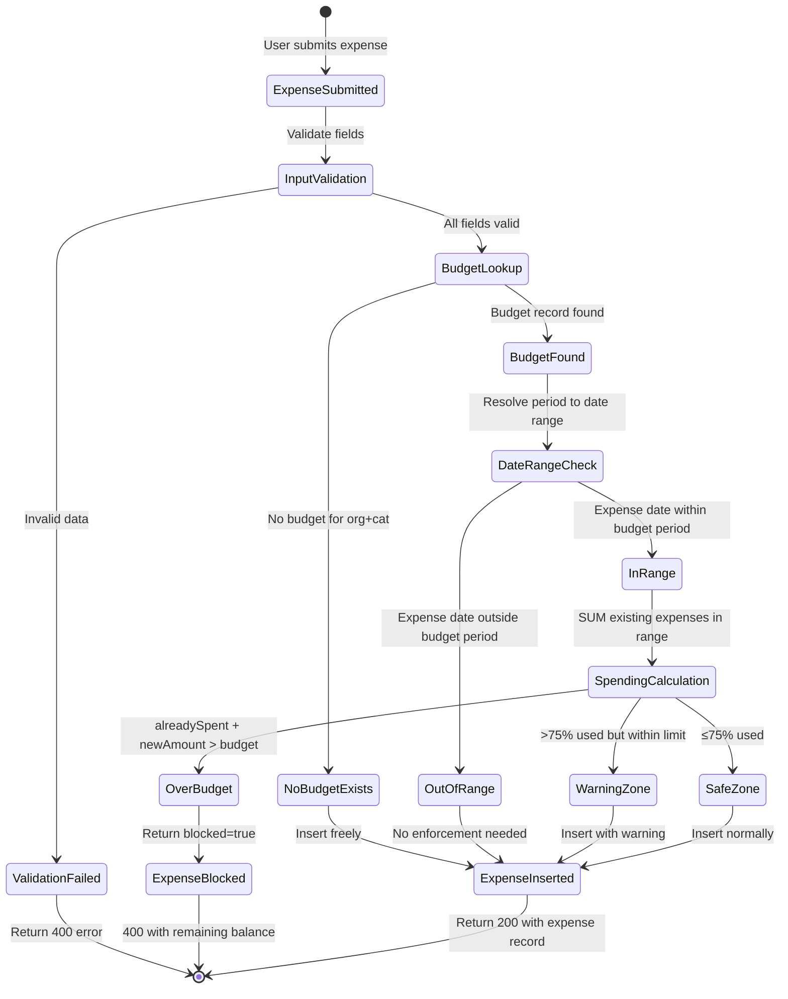

---

## 4. Implementation in Real

### 4.1 System Architecture

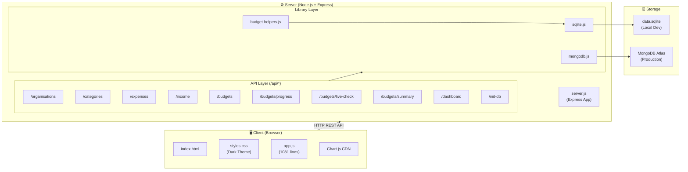

### 4.2 Technology Stack Implementation

| Layer | Technology | Implementation Details |
|:------|:-----------|:----------------------|
| **Frontend** | HTML5, CSS3, Vanilla JS | Single-page app with view switching (no framework). Dark theme with CSS variables. 471-line HTML, 1081-line JS |
| **Charts** | Chart.js | Doughnut chart for category-wise expense breakdown |
| **Backend** | Node.js + Express 4.18 | RESTful API with `app.all()` routing. ES Modules (`"type": "module"`) |
| **Local DB** | SQLite via `node:sqlite` | Built-in Node.js SQLite module (no npm dependency). WAL mode + foreign keys enabled |
| **Cloud DB** | MongoDB 7.x via `mongodb` npm | Connection pooling, atomic counters, serverless-compatible |
| **Hosting** | Vercel (Serverless) | Auto-deploy on git push. `vercel.json` with `cleanUrls: true` |
| **Dev Tools** | nodemon 3.x | Hot-reload during development |

### 4.3 API Endpoints (Complete)

| Method | Endpoint | Purpose |
|:-------|:---------|:--------|
| `GET/POST/PUT/DELETE` | `/api/organisations` | Full CRUD for organisations |
| `GET/POST/PUT/DELETE` | `/api/categories` | Full CRUD for categories |
| `GET/POST/PUT/DELETE` | `/api/expenses` | Full CRUD for expenses (with budget enforcement on POST) |
| `GET/POST/PUT/DELETE` | `/api/income` | Full CRUD for income records |
| `GET/POST/PUT/DELETE` | `/api/budgets` | Full CRUD for budgets |
| `GET` | `/api/budgets/progress` | Budget progress with computed spent/remaining |
| `GET` | `/api/budgets/live-check` | Real-time budget check for expense form |
| `GET` | `/api/budgets/summary` | Budget summary for specific org + category |
| `GET` | `/api/dashboard` | Aggregated income, expenses, category breakdown |
| `GET/POST` | `/api/init-db` | Database initialization and index setup |

### 4.4 Key Implementation Patterns

#### Budget Period Resolution
The system supports three period formats that are resolved into date ranges:

| Period Format | Example | Date Range |
|:--------------|:--------|:-----------|
| Monthly | `2026-10` | 2026-10-01 → 2026-10-31 |
| Quarterly | `2026-Q1` | 2026-01-01 → 2026-03-31 |
| Yearly | `2026` | 2026-01-01 → 2026-12-31 |

#### Cascade Delete Strategy
When an organisation is deleted, the system manually deletes child records in order:
1. Expenses (by `org_id`)
2. Income (by `org_id`)
3. Budgets (by `org_id`)
4. Categories (by `org_id`)
5. Organisation itself

> [!TIP]
> SQLite's `FOREIGN KEY ... ON DELETE CASCADE` is also enabled via `PRAGMA foreign_keys = ON`, providing a safety net.

### 4.5 Frontend Navigation Architecture

The SPA uses a view-switching pattern with CSS classes:

```
Sidebar Navigation (5 items)
  ├── Dashboard View    → summary cards + Chart.js doughnut
  ├── Organisations View → form + table (all orgs)
  ├── Expenses View     → expense form + category form + budget indicator + table
  ├── Income View       → income form + table
  └── Budgets View      → stats cards + budget form + filter bar + budget cards grid
```

Each view is a `<section>` with class `view`. The active view gets class `active-view`. Org-scoped views show a "No Organisation Selected" prompt until an org is chosen.

---

## 5. Project Report (Progress)

### 5.1 Overall Completion Summary

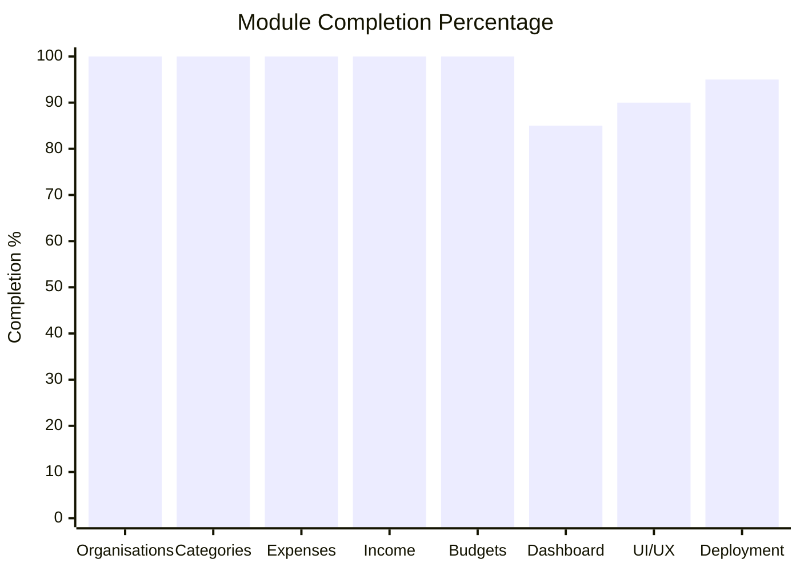

### 5.2 Module-wise Completion

| Module | Status | Completion | Remarks |
|:-------|:-------|:-----------|:--------|
| **Organisation CRUD** | ✅ Complete | 100% | Add, Edit, Delete, View all working. Cascade delete implemented |
| **Category CRUD** | ✅ Complete | 100% | Per-org categories with cascading dropdowns |
| **Expense CRUD** | ✅ Complete | 100% | Full CRUD with budget enforcement and blocking |
| **Income CRUD** | ✅ Complete | 100% | Full CRUD with source, date, description |
| **Budget CRUD** | ✅ Complete | 100% | Monthly, Quarterly, Yearly periods. Progress cards. Status filtering |
| **Budget Enforcement** | ✅ Complete | 100% | Hard block when over-budget. 75% warning threshold |
| **Live Budget Indicator** | ✅ Complete | 100% | Real-time indicator on expense form |
| **Dashboard** | 🟡 Mostly Done | 85% | Income/expense totals + doughnut chart. Missing: multi-org comparison, date range filters, trend analysis |
| **UI/UX** | 🟡 Mostly Done | 90% | Dark theme, mobile responsive, toast notifications. Missing: loading skeletons, form validation feedback icons |
| **Deployment** | 🟡 Mostly Done | 95% | Vercel + MongoDB Atlas stack working. Missing: CI/CD tests, environment health checks |
| **Authentication** | ❌ Not Started | 0% | No user login, roles, or access control |
| **Data Export** | ❌ Not Started | 0% | No CSV/PDF export capability |
| **Audit Trail** | ❌ Not Started | 0% | No logging of who made what changes |

### 5.3 What Is Done (Completed Features)

1. ✅ **Full 5-module backend** — Organisations, Categories, Expenses, Income, Budgets with complete REST APIs
2. ✅ **Dual-database support** — SQLite for local dev, MongoDB Atlas for production
3. ✅ **Smart budget enforcement** — Expenses blocked when exceeding budget; 75% warning threshold
4. ✅ **Live budget indicator** — Real-time budget status on expense form
5. ✅ **Dashboard with charts** — Income vs Expense summary with Chart.js doughnut
6. ✅ **Budget progress cards** — Animated progress bars with On Track / Warning / Over Budget status
7. ✅ **Mobile responsive UI** — Sidebar + hamburger menu + overlay
8. ✅ **Toast notification system** — Success/warning/danger with progress bar auto-dismiss
9. ✅ **Organisation scoping** — All data is filtered by selected organisation
10. ✅ **Seed data migration** — Auto-populates sample data on first run
11. ✅ **Vercel serverless deployment** — Production-ready with auto-deploy

### 5.4 What Is Remaining (Future Scope)

| Priority | Feature | Description |
|:---------|:--------|:------------|
| 🔴 High | **User Authentication** | Login/signup, JWT or session-based auth, role-based access (admin, viewer) |
| 🔴 High | **Multi-user Support** | Different users managing different organisations |
| 🟡 Medium | **Data Export** | Export expenses, income, and budgets to CSV or PDF |
| 🟡 Medium | **Date Range Filters** | Filter dashboard and tables by custom date ranges |
| 🟡 Medium | **Expense Edit** | Currently expenses can only be added/deleted, not edited from the UI |
| 🟡 Medium | **Income Edit** | Same as above — no inline edit from the UI |
| 🟢 Low | **Loading Skeletons** | Placeholder UI while data is being fetched |
| 🟢 Low | **Search & Pagination** | Search across records, paginate large tables |
| 🟢 Low | **Trend Charts** | Month-over-month spending trends, income growth |
| 🟢 Low | **Budget Notifications** | Email or push alerts when approaching budget limits |
| 🟢 Low | **Audit Trail** | Log of all CRUD operations with timestamps and user info |
| 🟢 Low | **Unit Tests** | Automated test suite for API endpoints |

### 5.5 Overall Project Health

| Metric | Value |
|:-------|:------|
| **Core Feature Completion** | **~95%** |
| **Overall Project Completion (incl. future scope)** | **~75%** |
| **Backend Readiness** | **Production-ready** ✅ |
| **Frontend Readiness** | **Production-ready (MVP)** ✅ |
| **Security Readiness** | **Not production-safe** ❌ (no auth) |
| **Total Source Files (excl. node_modules)** | **15 files** |
| **Frontend JS Lines** | **~1,081** |
| **Backend JS Lines** | **~750** |
| **Database Tables** | **5 (+1 MongoDB-only counters)** |
| **API Endpoints** | **10 routes** |

> [!WARNING]
> The biggest gap for production use is the **lack of authentication and authorization**. Currently, anyone with the URL can read/modify/delete all data. This must be addressed before any real-world deployment with sensitive financial data.

---

*Report generated on 29 October 2026 by analysis of the complete Oikos Expense Manager codebase.*
